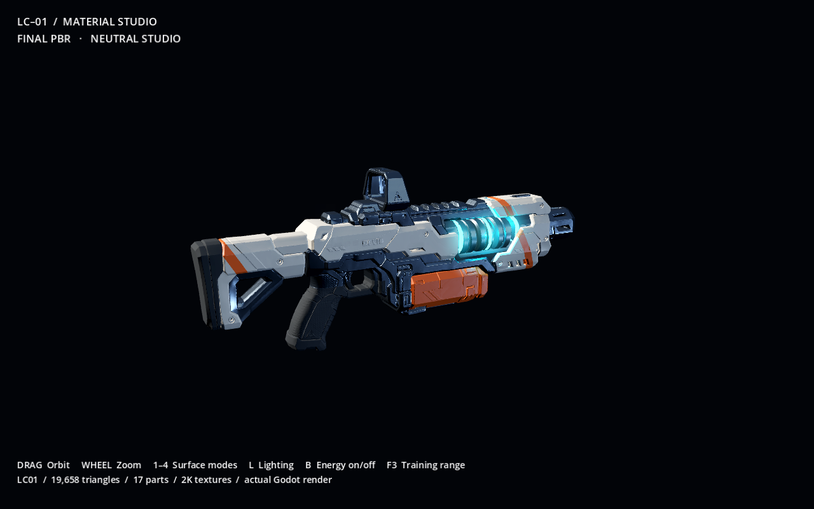

# Luna-Shot-FPS

独立月球能源设施训练场，64×66 m。A/B1/B2/C/D/E 六件资产完成白模、高模、低模/UV、真实 Normal/AO 烘焙、PBR 和 Godot 集成，复用为 59 个实例。LS01 保留红点瞄准和可击倒靶；新增低角度日照、设施灯、反射探针、能量环轮廓外 Bloom 与 imagegen 镜头光晕。无回合、无刷怪、无游戏流程。

## 运行

macOS 双击 `launch.command`，或用 Godot 4.7.2 打开 `project.godot` 后按 F5。当前验证平台为 macOS / Apple M5 / Compatibility 渲染器。

启动脚本会自动查找 `/Applications`、用户 Applications 目录或 PATH 中的 Godot，并先导入资源。自定义安装路径可用 `GODOT_BIN="/完整路径/Godot" ./launch.command`；导入日志位于 `artifacts/launch/import.log`。脚本支持透传 Godot 启动参数。

WASD 移动 · 鼠标视角 · Shift 冲刺 · 空格跳跃 · 左键射击（一枪击倒 T 系列靶，F5 复位） · **右键红点瞄准** · R 换弹 · F2 总览 · **F3 材料检查室** · F5 重置 · ESC 暂停。

光效调试：**F6 能量环 · F7 Bloom · F8 镜头光晕 · F9 局部补光**。

也可单独运行 `launch-weapon-lab.command`：拖动旋转、滚轮缩放、1–9 切换最终材质/关闭法线/统一响应/灰模/底色/金属度/粗糙度/AO/仅烘焙法线、L 切换灯光、B 能量开关、F3 返回训练场。

## 项目日志

[日志索引](docs/logs/README.md) · [ML01-枪械建模](docs/logs/ML01-枪械建模.md) · [ML02-过程生成白模](docs/logs/ML02-过程生成白模.md)

## 本轮产物

- [ML05-A 配电机组精修](docs/logs/ML05-A配电机组精修.md)：六块顶盖、检修门、三路接口和线缆；5,180 三角，无新增 Tripo 消费。
- [A 新旧原生对照](docs/validation/A-refine-v2/review.html)。A 的最新可编辑来源为 `art_source/environment/A-refine-v2/`，其余五件仍使用 ML03 来源。

- [ML03-环境模块建模](docs/logs/ML03-环境模块建模.md)：六资产共 690 Tripo 积分，18 次任务全部成功。
- [ML04-光照与镜头效果](docs/logs/ML04-光照与镜头效果.md) · [原生光照对照页面](docs/validation/lighting-v1/review.html)
- [六资产数据](docs/validation/environment-pipeline-v1/PIPELINE.md) · [逐任务费用](docs/validation/environment-pipeline-v1/CREDITS.md)


以下为此前白模和枪械阶段记录。

- [能源设施设计、模块规格与生成命令](docs/design/WHITEBOX.md)
- [能源设施实机验证](docs/validation/energy-whitebox-v2/README.md)


- [枪械管线、费用、实机证据和限制](docs/validation/rifle-pipeline-v2/README.md)
- [可交互的实机材质对照](docs/validation/rifle-pipeline-v2/review.html)
- [本轮部件实现对照](docs/art/rifle-pipeline-v1/IMPLEMENTATION.md)
- [原枪械幻想图与 spec](docs/art/rifle-v1/SPEC.md)
- [训练场白模设计](docs/design/WHITEBOX.md)
- [原始白模阶段验证](docs/validation/whitebox-v1/README.md)



运行时资产：`assets/weapons/lc01/lc01.glb`。完整可编辑来源与分阶段产物：`art_source/weapons/lc01/pipeline-v2/`。最终 Blend：`07-final/lc01-final.blend`。原 B0 白模保留在上一层，v1 全部阶段及旧截图保留。

ML01 枪械阶段实际使用 115 Tripo 积分（60 + 35 + 20），没有重抽。19,658 三角面、17 部件、四张 2K 贴图。已经打通管线，但自动网格仍有局部折面/接缝和 UV 利用率偏低等限制，不将概念图当作已达到的实机质量。

`tools/validate.sh` 检查训练场回归，`tools/validate_rifle.sh` 检查枪械、红点、场景切换及实际材质截图。二者会打开原生窗口并自动退出。构建入口与范围见 AGENTS.md。

光照专项：`tools/validate_lighting.sh`。运行时环境 GLB 位于 `assets/environment/{A,B1,B2,C,D,E}/`，可编辑源文件位于 `art_source/environment/pipeline-v1/`；生成器默认保留精模，`--art whitebox` 可导出原白模。

## ML07 枪械返修

保留的 ML07 LS01 返修资源在 `assets/weapons/lc01/ls01_v1`，可编辑高低模、独立 cage 和材质源在 `art_source/weapons/lc01/ls01-refine-v1`。`APPROVED` 标记仅代表本轮技术与实施复查，不代表用户已验收。原 LC01/ML06 资源保留，双击 `launch-weapon-baseline.command` 可对照。

[新旧原生画面对照](docs/validation/ls01-refine-v1/review.html) · [检查报告与开放差距](docs/validation/ls01-refine-v1/REPORT.md) · [逐件规格](docs/art/ls01-refine-v1/PARTS.md) · [复现步骤](tools/ls01_refine/README.md) · [ML07 日志](docs/logs/ML07-枪械精确几何与分层材质返修.md)。

## GitHub 与获取资产

私有仓库：[YicongCao/Luna-Shot-FPS](https://github.com/YicongCao/Luna-Shot-FPS)。需要仓库访问权限及 Git LFS，模型和贴图不能仅靠 ZIP 中的 LFS 指针运行。

```sh
# 先安装 Git LFS（macOS 可用 brew install git-lfs）
git lfs install
git clone git@github.com:YicongCao/Luna-Shot-FPS.git
cd Luna-Shot-FPS
git lfs pull
./launch.command
```

源文件、有效烘焙与验证证据已版本化；失败烘焙的重复二进制、缓存和临时产物留在本地。工作经验与提交约定见 [ML08](docs/logs/ML08-资产管线复盘与版本归档.md)。

## ML09 结构还原

2026-11-16 用户比较三版实机后选择 ML06，当前默认已回滚为 ML06。ML07、ML09 保留为对照，不作为用户认可的视觉升级。

在ML07分层材质基础上，恢复ML06/概念的弹夹分段、枪托宽倒角及黑白斜接、八角瞄具和前后安装鳍片、下移端点的不规则六边形嵌入屏，以及能量环附近护罩支撑。增加两盏受遮挡的青色侧向补光。阶段证据和用户验收分开记录。

[ML06/ML07/ML09 原生对照](docs/validation/ls01-refine-v2/review.html) · [验证报告](docs/validation/ls01-refine-v2/REPORT.md) · [逐件清单](docs/art/ls01-refine-v2/PARTS.md) · [ML09 日志](docs/logs/ML09-枪械结构还原与能量环侧向照明.md)。

Godot命令行显式选择：`-- --weapon-revision=ml06`、`ml07`或`ml09`。不传参数时固定采用 ML06，APPROVED 不再自动切换默认；`LS01_BASELINE=1`仍可回ML06，`LS01_CANDIDATE=1`保留ML07候选语义。新源在`art_source/weapons/lc01/ls01-refine-v2`，运行资产在`assets/weapons/lc01/ls01_v2`。重建已发布资产时需选新的`--out`/`--runtime`目录。
