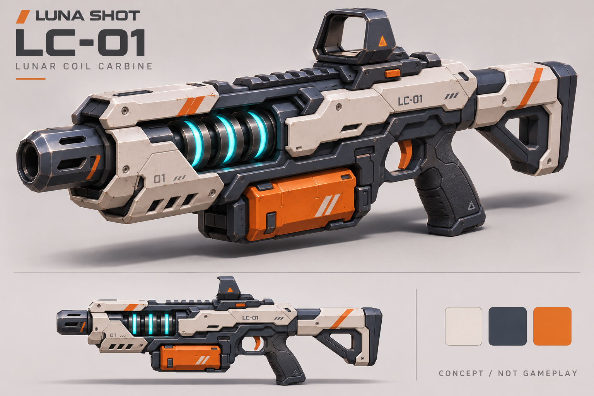

# LC–01 月面线圈卡宾枪 · 美术制作规格 v0.1

2026-11-15。状态：**游戏分件白模已实现；幻想图已生成；精修尚未开始。** 本文是虚构游戏道具的外观、动画和数字资产规格，不包含现实武器的内部机构或制造参数。

这张图由内置 imagegen 生成，完整提示词见 [prompt.txt](prompt.txt)。参考旧 Luna-Shot-Demo 的第一人称概念图与新项目白模实拍。它表达最终美术方向，不是游戏截图，也不是可以直接烘焙的模型。

## 方向与取舍

保留旧案的白壳、黑芯、橙色操作件、少量青色状态光。LC–01 的识别点是三段环形线圈、可拆分左右装甲、短枪托、开放式方形瞄具以及单一橙色能源匣。面板优先呈现大、中尺度结构；螺钉、划痕、通风孔不能代替轮廓设计。背景设备仍停留在白模，首个精修资产只做这把枪。

概念图透视和侧视有生成误差，不能据图描出两套互相冲突的零件。当前白模能源匣偏竖直，图中更横长；当前枪托是实心代理，图中有减重开口。**两项均属于下一版 B1 轮廓修改候选，未自动当作已批准的最终结构。** B1 要在同一个实机镜头比较后再冻结。瞄准轴、枪口挂点、握持区域不能因为追图随意漂移。

## 坐标、尺寸与模型合同

- 当前 Godot 源：`assets/whitebox/lc01.tscn`；Blender 可编辑源：`art_source/weapons/lc01/lc01-whitebox.blend`；配套 GLB 是同一代理，不是精修资产。
- 1 单位 = 1 m。Godot +X 为右、+Y 为上、−Z 为枪口方向；原点在主握把上方的装配基准。Blender +Z 向上、+Y 向枪口，导出转换回 Godot。禁止靠导入端补偿 100 倍比例。
- 白模包络：长约 **0.905 m**、宽 **0.151 m**、高 **0.454 m**。尺寸是游戏资产包络，不是制造尺寸；B1 如调整，必须更新表、挂点、Blender 源和实机证据。
- 下面尺寸按 Godot 局部轴列 `X宽 × Y高 × Z长`，位置是分件中心。数值来自生成器；圆柱尺寸表已转换成摆正后的包络。
- 当前根节点保存总装基准；每个代理零件 pivot 位于自身中心。精修时静态件保持总装对齐，活动件以对应 Socket 作为动画基准。不能把高模拆件后分别居中导出。

| 部件节点 | 中心 X/Y/Z（m） | 当前包络 宽×高×长（mm） |
|---|---|---|
| P01_Chassis | 0.000, 0.055, -0.170 | 85 × 120 × 500 |
| P02_LeftShell | -0.058, 0.085, -0.130 | 35 × 140 × 350 |
| P03_RightShell | 0.058, 0.085, -0.130 | 35 × 140 × 350 |
| P04_ForeShroud | 0.000, 0.065, -0.470 | 140 × 140 × 230 |
| P05_Stock | 0.000, 0.025, 0.160 | 120 × 180 × 160 |
| P06_Grip | 0.000, -0.090, 0.015 | 75 × 180 × 85 |
| P07_Cell | 0.000, -0.095, -0.150 | 90 × 200 × 120 |
| P08_SightBase | 0.000, 0.170, -0.120 | 80 × 25 × 105 |
| P09_SightLeft | -0.044, 0.215, -0.120 | 12 × 75 × 70 |
| P09_SightRight | 0.044, 0.215, -0.120 | 12 × 75 × 70 |
| P09_SightTop | 0.000, 0.253, -0.120 | 100 × 12 × 70 |
| P10_TriggerGuard | 0.000, -0.055, -0.055 | 25 × 25 × 65 |
| P11_Muzzle | 0.000, 0.065, -0.625 | 88 × 88 × 80 |
| P12_Coil0 | 0.000, 0.065, -0.310 | 146 × 146 × 18 |
| P12_Coil1 | 0.000, 0.065, -0.353 | 146 × 146 × 18 |
| P12_Coil2 | 0.000, 0.065, -0.396 | 146 × 146 × 18 |

原始结构数据：[rifle-blockout-parts.json](../../design/rifle-blockout-parts.json)。编号是资产标识，不表示现实功能设计。P09 的三根框架与 P12 的三个线圈目前为独立子件。

当前分件的确定性投影示意：[白模三视与部件色卡](blockout-views.svg)。它从代理包络生成，圆柱画为包络矩形；不是概念图的自动精确重建。

## 分件制作要求

| ID | 高模要解决的形体 | 低模与 UV 要点 | 动画 / 材质要求 |
|---|---|---|---|
| P01 | 贯穿机身的深色承力外观；有清晰面层转折，避免细碎台阶 | 保留侧面轮廓和上下导向结构；背面只保留需要的形 | 固定；深蓝灰金属。只描绘外壳，不做内部发射结构 |
| P02 / P03 | 左右独立白壳；大斜切面、接缝、可见倒角 | 左右非对称标识不重叠 UV；看不见的一侧允许降低密度 | 固定；涂层金属，擦损只集中边缘与操作区 |
| P04 | 前护罩围合三环，留可见开窗；不把线圈封成白砖 | 开窗与轮廓必须几何实现；细凹槽可烘焙 | 固定；米白主面、深色内壁 |
| P05 | 短枪托、托腮过渡、尾部软垫；B1 再确认开口 | 靠近相机的顶部和尾部不露断面 | 固定；白壳 / 聚合物；暂不做伸缩机构 |
| P06 | 握把轮廓与手套握持体积成立 | 纹理不靠密集网格堆出来；接缝放背面 | `GripR`；深色橡胶/聚合物 |
| P07 | 单一橙色能源匣；抽取方向可读 | 独立网格和完整底面，换弹时可见面都需 UV | `CellSocket`；沿局部 −Y 抽出；B1 评估横长比例 |
| P08 | 瞄具底座与机身连接可靠 | 保留瞄具支撑轮廓 | 固定；深色金属 |
| P09 | 开放式瞄具框，边缘厚度适合第一人称 | 洞必须是真洞；正反内壁完整，避免遮住中心线 | 固定；玻璃后续单独评估，首版不依赖折射 |
| P10 | 扳机护圈与握持空间，先做外观代理 | 护圈用真实轮廓；不填成实心黑块 | 可视小件；扳机后续独立动画，不在此版实现 |
| P11 | 短护套与可见内腔，正面读形 | 枪口轮廓和凹腔使用几何；深处可封底 | `MuzzleSocket`；禁止用纯黑平面代替最终内腔 |
| P12 | 三个一致的环状外部能源模块及暗色间隔 | 三环独立；可复用 UV，但磨损变化不能完全复制 | 青色发光带 + 暗色金属；不让发光抹平轮廓 |

## 挂点与第一人称验收

| Socket | Godot 坐标 m | 用途 |
|---|---|---|
| MuzzleSocket | (0, 0.065, −0.670) | 视觉枪口特效方向 −Z；不是物理弹道参数 |
| SightRear | (0, 0.216, −0.070) | 瞄准轴后点 |
| SightFront | (0, 0.216, −0.170) | 瞄准轴前点，与后点同 X/Y |
| GripR | (0, −0.080, 0.015) | 主手握持中心占位 |
| GripL | (0, −0.035, −0.430) | 副手护木握持中心占位 |
| CellSocket | (0, −0.040, −0.150) | 能源匣装配/动画基准 |

当前原型没有手臂和手指模型；GripR/L 是下一阶段对齐要求，不能据此声称手部穿插已通过。当前换弹仅做能源匣上下代理运动。20 发、1.5 秒换弹、无限备弹是自由训练参数，非现实能量或射速规格。

腰射相对武器相机 `(0.24, −0.29, −0.60)`，开镜 `(0, −0.216, −0.50)`。独立透明 Viewport 防止靠墙时整枪被场景裁切；射击仍检查世界碰撞与枪口前方遮挡。世界垂直 FOV 72°→52°，武器 62°→52°。双挂点开镜后位于屏幕中心轴，实机验证数值误差 <2 mm。

最终验收至少覆盖腰射、开镜、退匣、插匣、冲刺、贴墙、低掩体边缘及 16:9/16:10/超宽画幅；现有截图是 16:10 和约 2.29:1。未对手机或手柄承诺。武器占屏 18–25% 作为后续轮廓目标，目前未做像素面积计量。

## 高模 → 低模 → UV → 烘焙 → PBR

| 阶段 | 应交付文件 | 通过条件 |
|---|---|---|
| B0 当前白模 | `.blend`、`.glb`、Godot 分件场景、尺寸/挂点数据 | 单位一致、部件齐全、在训练场能腰射/开镜；本轮已具备 |
| B1 轮廓冻结 | 同一来源的三视图、第一人称截图、修改记录 | 解决横长能源匣与枪托开口；先用纯灰材质检查比例、双手空间与瞄准线 |
| H 高模 | `lc01-high.blend`，命名 `Pxx_*_high` | 每件主要形体、开口、倒角成立；中性转台中无阴影破面。微噪声暂缓 |
| L 低模 | `lc01-low.blend`，命名 `Pxx_*_low` | 总枪建议 20–28k 三角；轮廓可读、无负缩放、无错误法线、固定导出三角化 |
| U UV | UV 图、checker 实机截图、UV 密度统计 | 唯一烘焙面无重叠；活动能源匣独立岛；缝放内/背面；相邻可见面密度接近 |
| B 烘焙 | 每件 cage、NormalGL、AO、检查图 | 按名称匹配高低模，分件烘焙避免互相污染；检查斜边、凹槽、接缝与可动件边缘 |
| M PBR | BaseColor、NormalGL、ORM、Emission、材质清单 | 同一模型先做干净材质，再有限磨损；没有烘死的环境光照与镜面高光 |
| I 实机替换 | GLB、材质资源、固定镜头组和性能记录 | 同一白模镜头逐张对比；没有依赖离线灯光才能好看的材质；空间碰撞不变 |

上述预算为本项目起点，后续按实际投影面积收敛。白模数据不算“已经完成低模/UV”。不从生成的带 PBR 成品开始倒推高低模；Tripo 若使用，只能辅助某个已界定阶段的形体探索，结果必须进入相同分件、拓扑和烘焙检查。

- 建议三角预算：骨架 3k、双壳合计 5k、护罩 3k、枪托 2k、握把 1.5k、能源匣 1.5k、瞄具 3k、护圈 0.5k、枪口 1.5k、三环合计 3k，总计约 24k。手臂另计；不把看不见的小螺丝当高优先级。
- 首版一个 2048² 图集、两个以内主要材质槽（不含将来可选瞄具玻璃）。近景不足时先看 UV 利用率与实际画幅，再论证升 4096²。屏幕近景部件优先，不能机械套用全地图贴图密度。
- 2k 基础 padding 从 16 px 起，检查 mip 1–4；扩边由烘焙工具完成。使用 MikkTSpace 一致切线；硬边原则上配 UV 缝。应用缩放、固定三角化后再烘焙和导出，不能烘完再改拓扑。
- NormalGL：切线空间 +Y；作为法线纹理导入。ORM：R=AO、G=Roughness、B=Metallic，线性数据；BaseColor/Emission 使用颜色空间。Godot 各通道显式指定，不能凭文件名猜。
- 涂层壳 metallic=0，裸露金属区域 metallic=1，橡胶=0；这些是材质分类，不是全枪统一滑杆。米白避免纯白，橡胶避免纯黑。粗糙度先分大材质，再做小范围变化。
- 青色发光保持窄带，关闭辉光仍能读出实体环。三环有相同外径和间距，禁止用大面积青光掩盖几何。

每阶段把中性灰/UV checker/法线预览与实机截图一并留存。任何失败先修该阶段，不同时推进环境 PBR、体积效果和新玩法。
