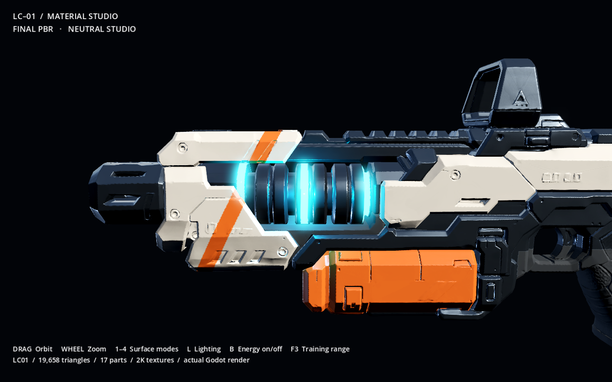

# LC01 v2 · 修复透面与能量环辉光

2026-11-15。针对用户指出的枪托尾部、枪管两侧透面，以及能量环缺乏发光感的问题。所有下方图片均为 Godot 4.7.2 / macOS / Apple M5 / Compatibility 实机截取。

[交互式修复前后对照](review.html) · [v1 管线及费用](../rifle-pipeline-v1/README.md)

## 原因与修复

**外壳材质没有开启透明。实际问题是部分外表面三角形朝向反了，被背面剔除后，只剩背侧内壁可见。** 此前仅检查面数、贴图和功能，没有检查每个部件的外表面方向，漏掉了这个明显视觉错误。

检查发现高模有 7 个部件、低模有 5 个部件的外侧法线反向；两阶段也存在不一致。已分别修正，保留正常的背面剔除。没有用全局双面材质遮掩，也没有填死概念图原本的枪托镂空和瞄具开口。

- 高模修正：T00 主骨架、T02 能量环、T07 顶轨、T08 枪托壳、T12 前握持区、T14 前支架、T15 轨道嵌件。
- 低模修正：T02、T08、T12、T14、T15；重新计算这些部件的加权顶点法线。
- 17 组高低模全部重新进行 Cycles 投射烘焙，替换 NormalGL/AO，并重新合成 ORM。保留 UV、几何位置、三角数和部件命名。
- 没有仅凭有符号体积判断朝向：例如 T09 是开口结构，体积符号为负但外侧方向正确，因此未盲目翻面。检查依据包含经确认的左右外表面方向及双侧原生截图。

源文件与逐件前后方向测量保存在 `art_source/weapons/lc01/pipeline-v2/orientation-repair.json`。此次修复脚本针对已确认的 LC01 部件，不能作为任意开放网格的通用自动修复器。

**能量环原来有 emission 贴图，但未启用辉光，且反向外表面让环体显示不完整。** 现已恢复完整外表面，使用 4.0 的发光强度、受控辉光和两个短距离青色补光，表现亮芯、光晕及近处金属受光。补光是游戏中的近似表现，不是全局光照模拟。普通表面仍保持原有 PBR。

当前 Godot Compatibility 支持辉光，沿用现有渲染器即可；参数采用其可用的 intensity、HDR threshold 和 HDR scale，未使用该实现不支持的辉光层级控制。[Godot 官方说明](https://docs.godotengine.org/en/stable/tutorials/3d/environment_and_post_processing.html#glow)

检查室新增 **B：关闭/开启能量发光与邻近补光**，保留 BaseColor。这样可以直接比较青色底色与实际发光效果。保持稳定发光，没有加入干扰瞄准的闪烁。

## 验证

- 17 个部件在高、低两个阶段均通过已定义外侧方向检查；原 7/5 个负向结果均修正为正向。
- Godot 强制不透明材质，仍使用 CULL_BACK。17 部件、19,658 三角面和四张 2K 贴图保持不变。
- **无窗口 19/19，原生窗口 29/29**。包含不透明/背面剔除、枪械视口辉光、能量开关、红点对齐与实际像素、命中、换弹、超宽窗口。
- F3 双向切换通过，最终导入和运行日志无错误。材料检查室生成左右侧、枪托近景、能量开关等 15 张对照；训练场另有 6 张截图。
- 同机位能量开关比较：指定环体附近区域约 20.4% 像素发生超过 2% 的 RGB 平均变化，确认发光开关实际影响画面；不是对概念图相似度的评分。
- 运行时 NormalGL 与新烘焙文件哈希一致；最终四张贴图与 v2 源文件一致。

本轮只重测受影响的枪械与材料功能，没有把 v1 的完整训练场移动回归冒称为本轮重跑。原来的局部拓扑不规则、碎 UV 岛和模糊刻字仍存在，与此次已修复的外表面反向问题分开记录。

## 使用与复现

运行项目或 `launch-weapon-lab.command`。检查室拖动旋转，滚轮缩放；1–4 材质模式、L 灯光、B 能量开关、F3 训练场。第一人称中右键红点瞄准、R 换弹。

v2 源目录：`art_source/weapons/lc01/pipeline-v2/`，包含修正后的 `02-high`、`04-low`、`05-bake` 和 `07-final`。`06-tripo-pbr` 显式引用已有 v1 付费输出。原 v1 文件和实机证据保留。

本地重建：`tools/weapon_pipeline/repair_surfaces.sh`。它读取已下载文件、修复、重烘焙、整理材质并验证，不调用 Tripo。单独复测：`tools/validate_rifle.sh`。

**本轮新增 Tripo 消费为 0；此前累计仍为 115 积分。** 运行时仍加载 `assets/weapons/lc01/lc01.glb`，最新完整源文件为 `art_source/weapons/lc01/pipeline-v2/07-final/lc01-final.blend`。
